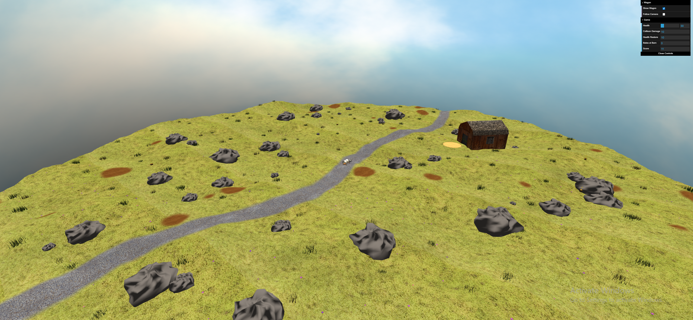
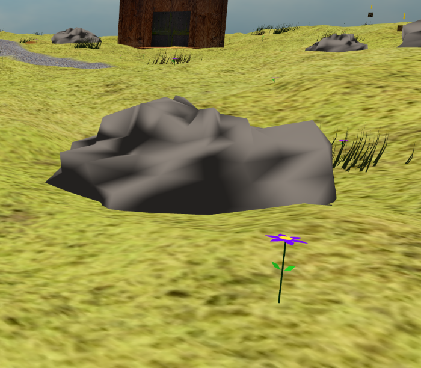
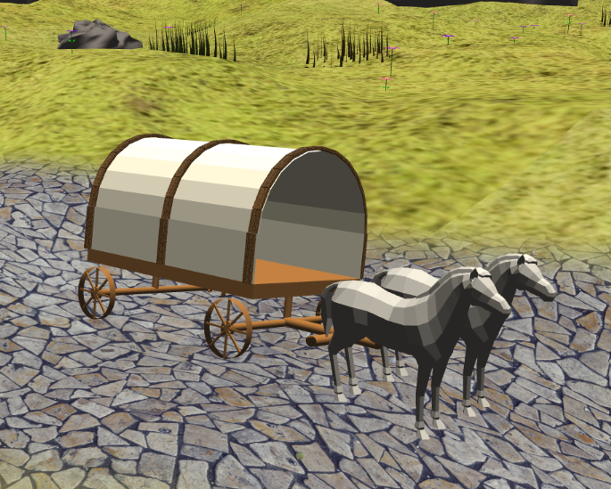
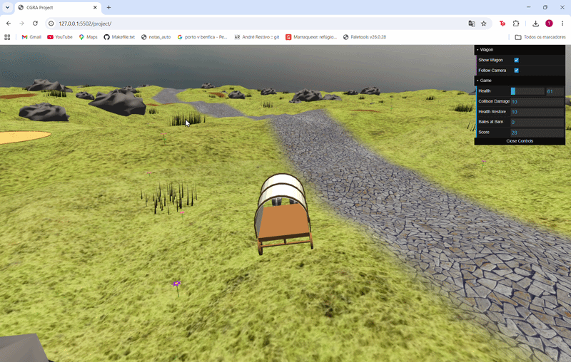

# CGRA 2025/2026 – Project

**Class:** T11 &nbsp;|&nbsp; **Group:** T11G08

| Name | Student Number | E-Mail |
|---|---|---|
| Vasco Vieira | 202307797 | up202307797@up.pt |
| Leonardo Carvalho | 202307152 | up202307152@up.pt |
| Tomás Costa Barros | 202303664 | up202303664@up.pt |

---

## Description

A rural farm scene where the player drives a horse-drawn wagon across a procedurally generated terrain to collect scattered hay bales and deliver them to the barn before health runs out.

The scene features a full day landscape with a sky dome, animated cloud dome, and a directional sun light. The terrain is generated with fractional Brownian motion (fBm) noise, with multi-texture blending between grass, a stone path, and dirt patches. Grass blades animate with a wind shader. Rocks are placed procedurally and rendered with a noise-based displacement shader. The horse model is loaded from an OBJ file. The wagon follows the terrain surface (pitch and roll). The gameplay loop consists of collecting hay bales (P) and delivering them to the drop zone near the barn (L), gaining health and score with each delivery.

---

## How to Run

No build step is required. The project uses native ES modules and WebGL 2.

1. Start a local HTTP server in the repository root (any static server works):
   ```
   python3 -m http.server 8000
   ```
2. Open a browser and navigate to:
   ```
   http://localhost:8000/project/
   ```

**Dependencies:** a browser with WebGL 2 support (Chrome, Firefox, Edge – recent versions).

---

## Keyboard Controls

| Key | Action |
|-----|--------|
| W | Accelerate forward |
| S | Brake |
| A | Steer left |
| D | Steer right |
| P | Pick up nearest hay bale (within range) |
| L | Deliver carried hay bales (when inside drop zone) |

---

## Implemented Features

### Base features
- **Terrain** – procedural height field using fBm noise; multi-texture blending (grass / stone path / dirt patches); anisotropic filtering and mipmaps
- **Sky dome** – textured hemisphere
- **Cloud dome** – semi-transparent dome with animated rotation
- **Sun** – directional light with configurable azimuth and elevation; sun marker sphere
- **Grass field** – instanced grass blades animated by a wind shader; two grass types (green and dry)
- **Flowers** – procedurally placed, per-instance random colour variation, stem height, and petal count
- **Rock field** – procedurally placed rocks with noise-based shader; collision detection
- **Stone path** – sinusoidal path across the terrain with stone texture
- **Dirt patches** – scattered dirt areas that suppress grass and flowers
- **Wagon** – multi-part model (body, cover, axles, wheels, tongue); follows terrain pitch and roll; wheel rotation tied to speed
- **Horses** – OBJ model loaded with texture; two horses placed in front of the wagon
- **Barn** – placed on the terrain with a drop zone in front
- **Hay bales** – ground bales with bobbing arrow indicators; carried bales displayed on wagon
- **Follow camera** – third-person camera that tracks the wagon

### Game mechanics
- Health bar that drains over time; restored by delivering hay bales
- Score counter (elapsed seconds while alive)
- Collision response against rocks and the barn (velocity reversal + damage)
- World boundary — wagon cannot leave the cloud sphere radius
- Game resets automatically when health reaches zero

### Advanced features
- **Procedural clouds** – animated cloud layer (as a second texture) near the sky-sphere.
- **Terrain using procedural generation** – procedurally generated height field using fractional Brownian motion (fBm) noise evaluated on the CPU (for physics queries) and in the vertex shader (for rendering).
- **Procedural generation of items** – dynamic and procedural placement of items, such as rocks with collision detection.
- **Procedural generation of flora items** – procedural generation of several components of flora items (flowers), with per-instance random colour variation, stem height, and petal count.
- **Wind simulation** – custom vertex shader to simulate "wind" over grass via time-driven deformation.
- **Highly detailed wagon** – highly detailed geometry and textures for the wagon, including multi-part animation (body, cover, axles, front/rear wheels, tongue), front wheel steering rotation on pivot, per-wheel spin tied to speed, and terrain pitch/roll alignment.
- **Physics-based acceleration** – acceleration using physics (kinematics) for realistic wagon movement.
- **Highly detailed barn** – highly detailed barn and circular area, featuring clear visual feedback for drop zones.
- **Visually convincing shaders** – advanced custom shaders including terrain shader with fBm-based height displacement and three-way texture blending (grass / stone path / dirt patches), and rock shader with noise-based colour variation.

---

## Known Issues / Limitations

- Only 3 of the 5 required screenshots have been captured so far (see below).
- The world is bounded by a sphere but the terrain geometry extends beyond it; the terrain edge is not visually clipped.
- Hay bale spawn placement may occasionally fail on extreme terrain heights (falls back to a floating position).

---

## Screenshots

> **5 screenshots are required.**

| | |
|---|---|
|  |  |
|  |  | !
---

## AI Use Declaration

AI tools (Copilot) were used during the development of this project to assist with debugging and code suggestions. Specifically, AI was consulted to help diagnose issues in JavaScript/WebGL code, suggest fixes for shader and game-logic bugs, and assist with developing complex features and improve features.

