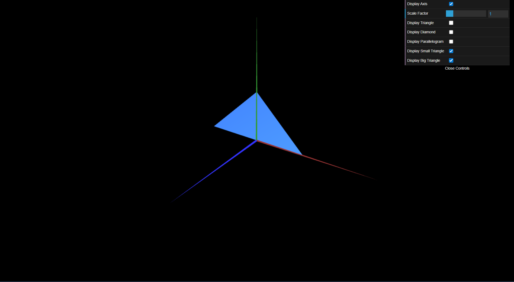

# CG 2025/2026

## Group T11G08

## TP 1 Notes

(add your main observations/remarks about your experiments here, in a bulleted list, and remove this line. Some examples below)

### Exercise 1

#### MyTriangle

A new subclass of `CGFObject` named `MyTriangle` was implemented in `MyTriangle.js`.

The class defines a right triangle in the XY plane with side length 2 units, according to Figure 2 of the assignment.  

The geometry is defined using:

- `vertices`
- `indexes`

and rendered using `gl.TRIANGLES`.

The object is instantiated in `MyScene` and displayed conditionally in the `display()` method.

#### GUI Controls

In `MyInterface`, new checkbox controllers were added to manage the visibility of the following objects:

- Diamond (`displayDiamond`)
- Triangle (`displayTriangle`)
- Parallelogram (`displayParallelogram`)
- Small Triangle (`displayTriangleSmall`)
- Big Triangle (`displayTriangleBig`)

The corresponding boolean variables were initialized in `MyScene` and used to conditionally render each object inside the `display()` method.

#### MyParallelogram

A new subclass `MyParallelogram` was created in `MyParallelogram.js`.

The parallelogram:

- Has height 1 unit
- Has total width 3 units
- Has its leftmost vertex at the origin (0,0,0)

To ensure it is **double-sided**, reversed index ordering was included so that the geometry is visible from both sides.

### Exercise 2

Two additional primitives were implemented:

- `MyTriangleSmall`
- `MyTriangleBig`

Each class defines its respective vertex and index arrays to match Figures 5 and 6 of the assignment.

Their visibility is also controlled via GUI checkboxes.

- In exercise 1 we observed X
- In exercise 2 we had difficulties in Y

## Screenshot (n = 1)

The following image corresponds to the required capture for this assignment.

