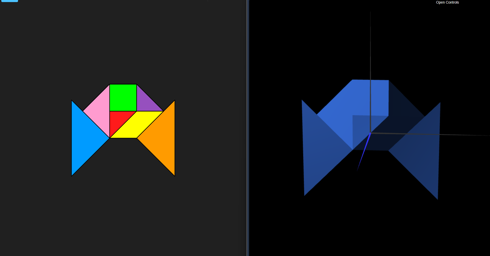
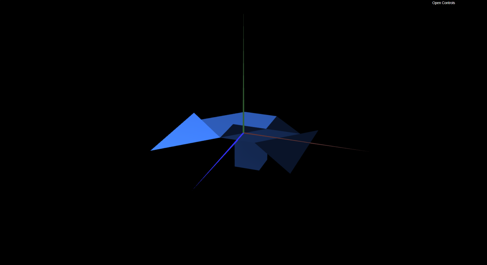
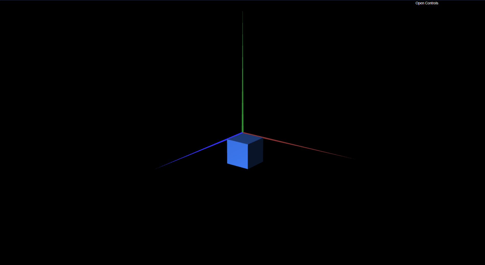

# CG 2025/2026

## Group T11G08

## TP 2 Notes

### Exercise 2

- Recreated the tangram layout from the group reference image.
- Placed `MyDiamond` in the XY plane using explicit matrix declaration and `multMatrix()`.
- Placed the remaining pieces using WebCGF transformation functions (`translate`, `rotate`, `scale`) with `pushMatrix()` and `popMatrix()` to reset the local reference.
- Created `MyTangram` as a composite `CGFobject` and moved piece-placement logic from `MyScene` to `MyTangram.display()`.

### Exercise 3

- Implemented `MyUnitCube` as a single triangle mesh.
- Defined 8 cube vertices with coordinates in the range `[-0.5, 0.5]` and 12 triangles for the 6 faces.
- Imported `MyUnitCube` in `MyScene`, instantiated it, and displayed it in the scene.
- Re-enabled tangram rendering and applied transformations so the cube acts as a base behind the tangram.
- Rotated/transformed the tangram-base set to be parallel to the XZ plane with the top-left base vertex at `(0, 0, 0)`.

### Exercise 4

- Implemented `MyQuad` as a unit square centered at the origin.
- Implemented `MyUnitCubeQuad` by drawing one `MyQuad` six times with the required translations and rotations.
- Replaced the previous cube in the scene by applying the same placement transformations to `MyUnitCubeQuad`.

## Screenshot (n = 1)

Exercise 2

## Screenshot (n = 2)

Exercise 3

## Screenshot (n = 3)

Exercise 4

